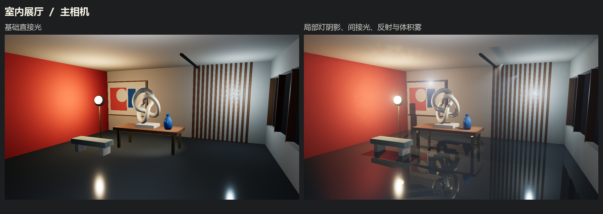

# 给室内展厅布光

在 Flare 启动页点击 **新建项目**，选择 **室内展厅**，在软件包以外的位置创建项目。也可以用 **打开项目** 选择已经创建的 `project.json`。点击 **运行预览** 后，展厅主相机能同时看到展桌、立灯、背墙和抛光地坪。按 **停止预览** 返回编辑。

## 摆一盏会投影的灯

1. 在 **场景层级** 选择 **琥珀点灯 · 桌面投影**。在 **属性** 面板移动灯的位置，观察桌脚与长椅在地面留下的影子。保留灯光强度，然后切换 **投射局部阴影**，可以单独观察遮挡的贡献。
2. 选择 **轨道聚光 · 展台**，旋转它使光斑从台面移到背墙。选中灯时，视口中的两圈线表示内、外锥范围。**内锥半角（度）** 内保持完整亮度，在 **外锥半角（度）** 处衰减至零；两角相同时得到硬边。
3. 要增设灯具，右键 **场景层级**，选择 **点光源** 或 **聚光灯**，再调整颜色、强度和作用范围。新建的这两种局部灯默认投影。要让个别物体透过灯光，可以关闭该网格的投影属性。

每帧最多有八个局部灯槽，所有聚光灯和勾选投影的点光源共用。超过容量时可在控制台看到提示。第九盏投影点光仍按普通点光参与，额外聚光按稳定实体顺序跳过。

## 用同一个镜头检查效果

选中 **室内光照设置**，保持主相机、曝光和布灯固定，每次只打开一个项目，然后运行预览。

| 设置 | 可以观察的变化 | 适用范围 |
| --- | --- | --- |
| **动态间接光（屏幕空间）** | 照亮铁红墙，观察附近中性表面暗部的染色；移灯后同一位置的间接光随之变化 | 从当前画面内可见的不透明表面估计一次反弹，原有环境或探针光照提供基础亮度 |
| **动态反射（屏幕空间）** | 移动可见的蓝釉瓶，观察磨光地坪中的倒影；粗糙度增大时倒影减弱 | 追踪当前屏幕可见几何，未命中、屏边和粗糙表面逐渐回到环境反射 |
| **体积雾** | 观察窗侧聚光照亮的空气，适当增大 **每米雾消光系数** 可增强散射和远处的遮蔽 | 沿视线积到不透明表面或 **雾的最远距离（米）**，随后绘制透明物体 |

保存场景后，可以重新打开项目或从构建与导出面板生成游戏。要复现同镜头的帧序列，固定主相机和时间步长，按[玩家画面抓帧流程](record-video.md)执行。

## 正式包的画面对比 {#gallery-comparison}

左图保留点光与聚光的直接照明。右图依次启用局部灯阴影、动态间接光、动态反射和体积雾。两张原始画面由正式包的 Player 从同一台主相机以 1280 × 720 输出，使用相同曝光和 1/60 秒固定步长。

在软件包的 `Guide` 目录中，打开 `IndoorGallery-Stages.png` 可按行单独比较上述四步。`IndoorGallery-Changes.png` 展示移动琥珀点灯、转动展台聚光和移动钴蓝釉瓶后，同一机位里的投影与倒影。
