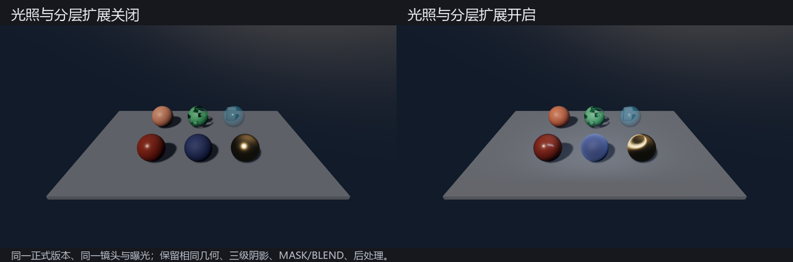

# 用渲染工作室调光

打开正式软件包里的 **FlareEditor.exe**，点击 **新建项目**，将模板设为 **渲染工作室**。输入项目名，保留默认父目录或另选可写目录，点击 **创建**。以后可以从最近项目进入，也可以通过“打开项目”选择项目目录。

## 看清六种材质

编辑视口中点击 **查看全部**。前排从左到右是清漆、绒布和拉丝金属，后排是次表面漫反射、裁切和半透明球。选中球体后按 **F** 可以靠近观察。编辑视口有自己的相机，播放时主相机给出模板预设的全景。

| 想调整的效果 | 在哪里改 | 观察哪里 |
| --- | --- | --- |
| 摄影棚的补光 | 在场景层级选择 **冷色矩形补光**，调整矩形面光的宽、高或辐亮度 | 在清漆和拉丝金属球的亮部看灯面宽窄与亮度的变化 |
| 金属表面的拉丝方向 | 在资源面板打开 `Content/Materials/Anisotropy.material.json`，调整 **各向异性旋转（弧度）** | 先记下原值 0.6，再改成约 2.17，观察拉长的高光转向 |
| 地面的接触阴影 | 在层级选择 **渲染设置**，开关 **方向光接触阴影** | 比较物体与地面相接处。**间接光环境遮蔽（GTAO）** 可以单独切换，观察暗面的环境光 |
| 裁切轮廓 | 在资源面板选择 `Content/Materials/Mask.material.json`，调整 **裁切阈值** | 观察绿色球表面的覆盖和它在地面的投影 |

点播放可用主相机查看，停止后返回编辑状态。保存场景和修改过的材质，再从启动页打开即可继续。模板自带环境和照明查找表；保留原脚本时，正式包可复用其预编译程序集。

## 同一镜头的画面

两幅图均来自渲染工作室导出游戏的第 12 帧，取景、曝光、三级方向光阴影和后处理相同。对照组关闭矩形补光、多散射、球谐漫反射、环境遮蔽、接触阴影与四种材质分层。想分辨某一项的贡献，可按上表一次只动一个参数。次表面球演示曲面上的漫反射，蓝色透明球演示背景混合。
